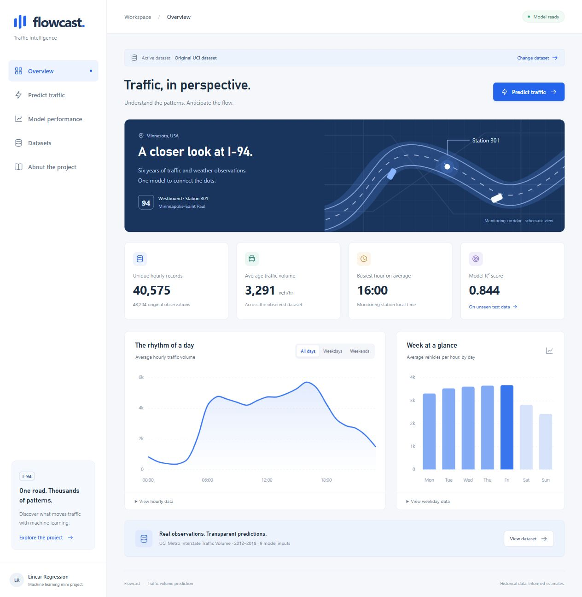
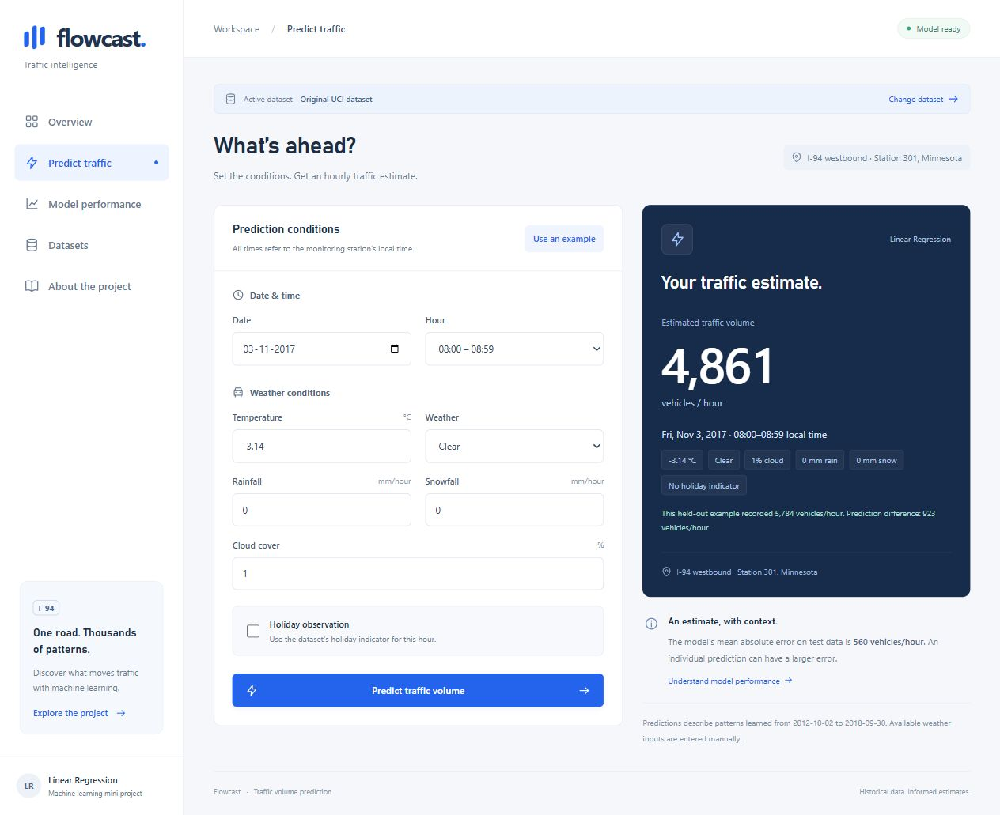
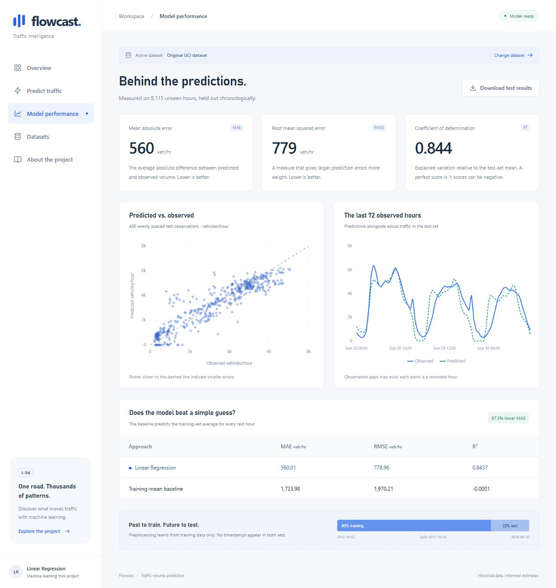
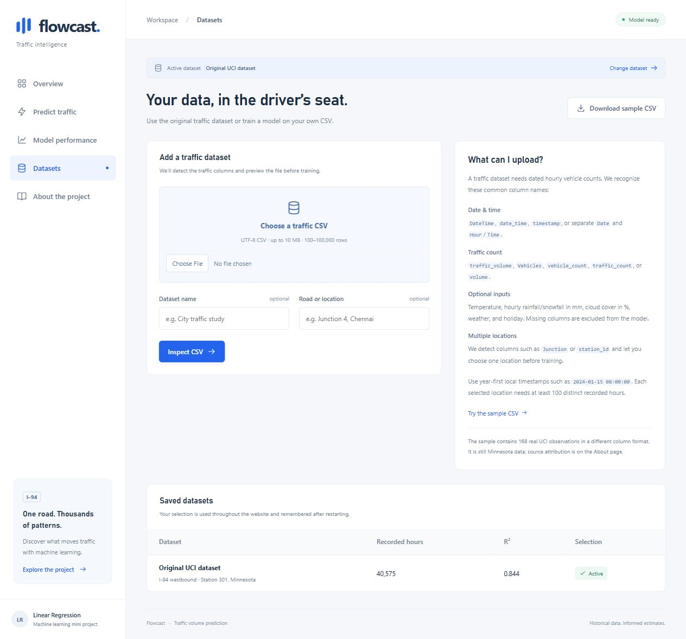

# Flowcast — Traffic Volume Prediction

A local website for the mini project **Traffic Volume Prediction Using Linear Regression**. Explore historical traffic, enter weather and calendar conditions, and compare a trained multiple Linear Regression model with a simple baseline.

## Screenshots

Click any screenshot to view it at full size.

| Traffic dashboard | Traffic prediction |
| --- | --- |
| [](artifacts/previews/dashboard-desktop.jpg) | [](artifacts/previews/prediction-desktop.jpg) |

| Model performance | CSV datasets |
| --- | --- |
| [](artifacts/previews/performance-desktop.jpg) | [](artifacts/previews/datasets-desktop.jpg) |

## Run on Windows

Use **Python 3.13**. In PowerShell, open this project folder.

If you have already completed setup on this computer, start it with:

```powershell
.\.venv\Scripts\python.exe app.py
```

Open **http://127.0.0.1:5000**. You can also double-click `start.bat`. Stop the server with **Ctrl+C**. The `.venv` directory is machine-specific; recreate it when moving the project to another computer.

### First setup on another computer

```powershell
py -3.13 -m venv .venv
.\.venv\Scripts\python.exe -m pip install --timeout 120 --retries 10 -r requirements.txt
.\.venv\Scripts\python.exe train.py
.\.venv\Scripts\python.exe app.py
```

No virtual-environment activation or PowerShell execution-policy change is needed. The initial dependency install and dataset download need internet. The original source archive, extracted CSV, saved model, and local Chart.js library are included in the prepared project; subsequent training and website use work offline. If the source archive is absent, `train.py` downloads it automatically. To retrain, stop the website, run `train.py`, then restart the website.

## Website pages

| Page | What it shows |
| --- | --- |
| Overview `/` | Real record counts, mean volume, peak hour, hourly traffic with weekday/weekend filters, and weekday averages. Expand data tables for exact chart values. |
| Predict traffic `/predict` | Date, hour, temperature, rain, snow, cloud cover, weather category, and a holiday indicator. A prediction is an estimated vehicle count during the selected hour. |
| Model performance `/performance` | Held-out MAE, RMSE, R², actual-vs-predicted scatter, final 72 observations, and a baseline comparison. Download full evaluation CSV. |
| Datasets `/datasets` | Upload and inspect traffic CSVs, train a model, and switch between the original and saved datasets. |
| About `/about` | Data attribution, preprocessing, feature engineering, chronological evaluation, and limitations. |

**Demo:** open Predict traffic, select **Use an example**, then **Predict traffic volume**. This loads a real held-out observation and shows its actual count alongside the estimate. Change the conditions and predict again. Dates outside the observed range are accepted as calendar scenarios and labelled accordingly.

The example is the first clear-weather weekday at 08:00 in the test set (or the middle eligible test observation if none exists). It is selected by conditions and chronology, not prediction error. Only presentation of measurements trims floating-point conversion artifacts; model inputs and predictions retain their numerical precision.

## Upload and switch traffic datasets

1. Open **Datasets** and choose a `.csv` file. You can download the included sample to try the feature.
2. Optionally name the dataset and identify its road/location, then select **Inspect CSV**.
3. Review the automatically detected columns, date range, counts, and preview. If temperature units are not identified from the header, choose Celsius or Kelvin. If multiple roads/stations are detected, choose one location.
4. Select **Train & use this dataset**. After successful chronological training/evaluation, the new model becomes active and the overview opens automatically.
5. Use **Saved datasets → Use this dataset** to switch back to the original UCI model or another saved model without retraining.

The active dataset controls predictions, charts, metrics, downloads, location labels, and example inputs throughout the website. Prediction fields absent from an uploaded file are excluded from its model and hidden in the form. A CSV with only date/time and counts trains a calendar-based model. The original UCI source and model are preserved. Failed inspection or training leaves the current dataset/model active. The selection is saved locally and restored after restarting; existing prediction tabs must reload after a switch.

**Supported CSVs:** UTF-8 (including BOM), comma/semicolon/tab separated, up to 10 MB and 100,000 rows. A selected road/station needs at least 100 distinct whole-hour timestamps and varying traffic counts. Common headers are matched without case, spaces, or underscore differences:

| Meaning | Recognized examples |
| --- | --- |
| Hourly timestamp | `DateTime`, `date_time`, `timestamp`, `recorded_at`, `observation_time` |
| Separate calendar fields | `Date` plus `Hour` (0–23) or `Time` (`08:00:00`) |
| Vehicle count | `traffic_volume`, `Vehicles`, `vehicle_count`, `traffic_count`, `vehicle_volume`, `volume` |
| Optional temperature | `temperature_c`/`temp_c` (°C), `temperature_k`/`temp_k` (Kelvin), or `temperature`/`temp` with confirmed units |
| Optional weather | `rain_1h`/`rainfall`, `snow_1h`/`snowfall` (mm/hour), `clouds_all`/`cloud_cover` (%), `weather_main`/`weather`, `holiday`/`is_holiday` |
| Optional location | `Junction`, `junction_id`, `station`, `station_id`, `location`, `road`, `sensor_id`, `intersection` |

Use local, year-first timestamps such as `2024-01-15 08:00:00`; timezone suffixes and ambiguous day/month-first dates are rejected. Sub-hourly records must be aggregated to hourly vehicle counts first. Counts must be finite and nonnegative. A generic speed, occupancy, or congestion CSV is not sufficient. Duplicate timestamps are removed only after selecting the location. Missing optional numeric readings use training medians; an optional numeric feature with no usable training readings is excluded. Unknown categories in evaluation or a future calendar scenario use the encoder's all-zero reference representation, so performance may decrease outside the observed conditions.

The sample download contains 168 real UCI observations under alternative column names, with temperature in °C. It retains the UCI dataset's Minnesota provenance and CC BY 4.0 attribution; it is not a new location's data. Other CSVs retain the uploader's provided location and provenance; the app does not infer a city from traffic counts.

Uploads, trained pipelines, evaluations, metadata, and the active-selection file are saved under `data/datasets/` (excluded from Git). Keep this folder to preserve saved datasets when moving the application. The local app serializes training/selection operations; ordinary prediction requests continue to use a consistent snapshot of the previously active model until activation succeeds.

## Data and modelling

- **Source:** [Metro Interstate Traffic Volume, UCI](https://archive.ics.uci.edu/dataset/492/metro+interstate+traffic+volume). Hogue, J. (2019). DOI: [10.24432/C5X60B](https://doi.org/10.24432/C5X60B). Dataset license: **CC BY 4.0**.
- **Location:** I-94 westbound, Minnesota DOT ATR station 301, between Minneapolis and Saint Paul, USA. The road illustration is a schematic, not a geographic map.
- **Target:** observed hourly traffic volume in vehicles/hour. This is not a congestion classification or travel-time estimate.
- **Original data:** 48,204 records, 2012-10-02 through 2018-09-30. Preserve the downloaded archive byte-for-byte under `data/raw/`. Its SHA-256 is stored in `artifacts/summary.json`.
- **Duplicate timestamps:** keep the first row in original source order, then sort chronologically. This leaves **40,575 unique observed hours**. Recorded hours are not a continuous hourly series.
- **Input features:** hour, weekday, month, binary holiday indicator, temperature in °C, hourly rain/snow in mm, cloud cover in %, and `weather_main`. The more detailed `weather_description` is omitted because repeated descriptions can refer to the same hour.
- **Holiday handling:** load the CSV with `keep_default_na=False` to preserve the literal `None` label. Any other source holiday name becomes 1. This is the dataset's hourly holiday indicator, not an automatically inferred full-day holiday calendar.
- **Cleaning:** temperatures outside −60 to 60 °C, negative numeric weather values, and cloud cover above 100% become missing values. Numeric missing values are filled with training-set medians. Numeric features are standardized using training-set statistics. Source rain/snow outliers otherwise remain; these can affect a linear model.
- **Encoding:** use one-hot encoding with a dropped reference category for hour, weekday, month, weather, and holiday. Weather choices in the form come from the training set. Unknown categories at transformation time are handled by the encoder.
- **Split:** earliest **32,460** hours for training (80%), latest **8,115** for evaluation (20%). No timestamp overlaps. The complete preprocessing pipeline is fitted only on training data.
- **Model:** scikit-learn `LinearRegression`. The date supplies month and weekday; the model does not use the year as a growth trend. No time/weather interaction features are added.
- **Postprocessing:** `max(0, prediction)` in both evaluation and serving. The API, CSV, and metrics preserve floating-point precision. Only the displayed website number is rounded.
- **Baseline:** predict the training-set mean for every evaluation hour. Its metrics use the exact same test data.

Saved outputs: `artifacts/model.joblib` (pipeline), `artifacts/summary.json` (metrics, data summaries, dates, version and source metadata), and `artifacts/evaluation.csv` (all actual, predicted and baseline values). Model files must be generated locally or obtained from a trusted source, because joblib loads Python objects. Keep the pinned scikit-learn version when using the supplied model; retrain after changing model dependencies.

## Prediction API

`POST /api/predict` with `Content-Type: application/json`:

```json
{
  "date": "2018-05-15",
  "hour": 8,
  "temperature": 20,
  "rainfall": 0,
  "snowfall": 0,
  "cloud_cover": 20,
  "weather": "Clear",
  "holiday": false
}
```

For the original model, all fields above are required. Uploaded models require date, hour, and only their available optional features (listed in `/api/summary` under `feature_columns`). Date uses `YYYY-MM-DD`; hour is an integer 0–23; temperature is −60–60 °C; rain and snow are finite nonnegative numbers; cloud cover is 0–100; holiday must be a JSON boolean. See `/api/summary` for supported weather categories. Times refer to the source monitoring station's local clock, not your computer's timezone. Optionally pass `dataset_id` from the summary; a stale ID returns 409 rather than silently predicting with another model.

A successful response contains `predicted_volume` (unrounded number), `unit` (`vehicles/hour`), and normalized `conditions`. Invalid input returns HTTP 400 with `message` and field-specific `errors`. Requests larger than 16 KB return 413. `/api/health` reports readiness. Prediction requests use the in-memory model and never retrain it.

Dataset endpoints: `GET /api/datasets` lists ready datasets and the active ID; `POST /api/datasets/inspect` accepts multipart `file` plus optional `name`/`location`; `POST /api/datasets/train` accepts JSON `id`, optional `temperature_unit` (`C`/`K`), and selected `location`; `POST /api/datasets/activate` accepts JSON `id` (`builtin` for the original). Inspection does not change the active model. Training persists the new artifacts before selecting them. Concurrent training/selection returns 409. CSV upload requests allow 10 MB files; prediction/JSON requests retain the 16 KB limit.

## Validation

The supplied model was evaluated on 8,115 held-out hours:

| Approach | MAE (vehicles/hour) | RMSE (vehicles/hour) | R² |
| --- | ---: | ---: | ---: |
| Linear Regression | 560.01 | 778.96 | 0.8437 |
| Training-mean baseline | 1,723.98 | 1,970.21 | -0.0001 |

The model reduces MAE by 67.5% against this baseline. These are measured historical test results, not a guarantee for future conditions.

```powershell
.\.venv\Scripts\python.exe -m pytest -q
```

Tests cover routes/local assets, API/Python prediction agreement, repeated predictions, missing and invalid inputs, malformed requests, chronological non-overlap, training-only imputation, re-computed metrics and baseline, evaluation downloads, and nonnegative predictions with preserved precision.

**Verified:** 75 automated tests passed, including CSV detection, training, switching, restart persistence, invalid uploads, and preservation of the original model's metrics. The three expected encoder warnings cover categories absent from a small training partition. Browser checks at 1280 × 900 and 390 × 844 covered the original four page layouts, navigation, chart filters, example prediction, changed hour, negative rainfall, and cloud cover above 100%. The CSV upload and column-detection preview was also checked in the browser. Preview images are saved under `artifacts/previews/`.

For a browser check, visit each page at desktop and phone widths, switch all hourly filters, submit the example, change conditions, and check invalid inputs. Charts use the locally included **Chart.js 4.5.1** (MIT; license at `static/vendor/Chart.js-LICENSE.md`), so the website makes no external requests during ordinary use.

## Limitations

This project demonstrates historical traffic modelling. It has no live weather or incident feed and no assumption that Minnesota traffic patterns generalize to Indian roads. Calendar features capture recurring patterns but do not model future changes, roadworks, major events, or all weather interactions. The observed test error is an average, not a confidence interval or guarantee for an individual prediction. R² is not an accuracy percentage. Descriptive overview charts use the full historical dataset; model training uses only the earlier training partition.

The app binds to `127.0.0.1`, runs without debug mode, and is intended for a local college demo. It does not require accounts, a database, or API keys.
